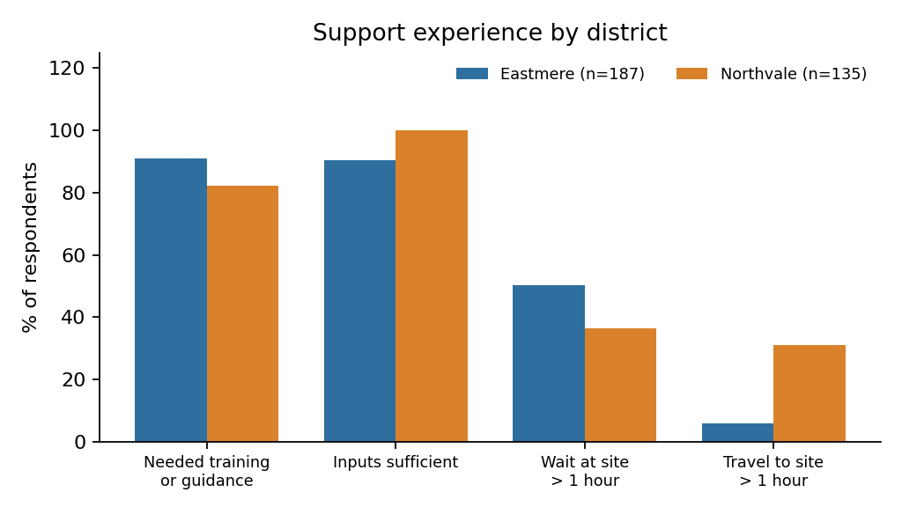
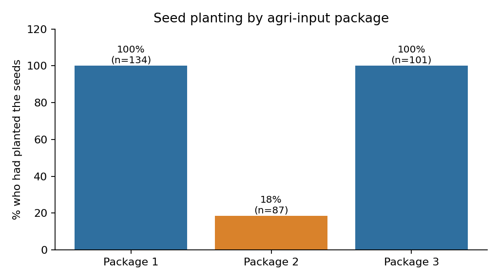
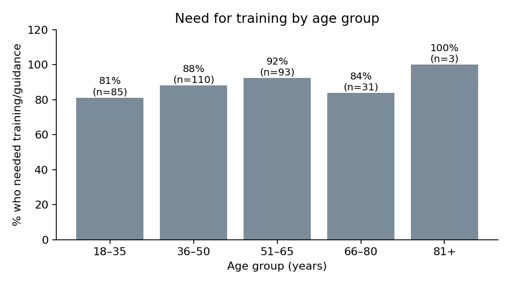

# Satisfied, but Not Yet Planted

### Turning a Post-Distribution Monitoring survey into actionable learning for a flood-recovery programme

*A monitoring, evaluation and learning (MEL) case study*

| | |
|---|---|
| **Role** | Monitoring & Learning analyst (individual technical exercise, time-boxed) |
| **Programme** | Flood Recovery Project, Tideline Relief *(organisation name anonymised)* |
| **Intervention** | Agricultural input packages plus LCU 2,700 unconditional cash to flood-affected smallholders |
| **Data** | Post-Distribution Monitoring (PDM) survey, Nov 2025, 322 of 605 participating households (53%) |
| **Tools** | Excel (PivotTables, slicer) for the original deliverable; Python (pandas, matplotlib) for this reproducible re-analysis |
| **Outputs** | Descriptive analysis, 419-word Pause & Reflect brief, survey-design recommendations |

---

## TL;DR

On the surface the programme looked like a success: **100%** of respondents rated input quality "good", **99%** said inputs suited their local context, **94%** said they were sufficient, and **nobody** paid a fee to receive support.

Disaggregating by agri-input package told a different story. **Only 18% of Package 2 households had planted their seeds, against 100% for Packages 1 and 3.** Headline satisfaction was hiding the single most important delivery problem. District-level comparisons could not isolate it, because package and district are almost perfectly confounded.

> **The lesson:** when every respondent says "good", the aggregate has stopped informing. The insight is in the cut you choose to make.

---

## 1. Context

Floods in May 2025 disrupted livelihoods in two districts of a flood-affected province. In August 2025 the project team ran a selection survey and chose 605 households to receive an agricultural input package and cash. In November 2025 a PDM survey was run with 322 households, selected through systematic random sampling and collected digitally.

Before the next round of distribution, the project team planned a **Pause & Reflect** session. My task was to analyse the PDM data and write a short discussion starter that would help the team correct course.

## 2. The questions I set out to answer

1. Who responded, and how do households differ across villages?
2. Did participants see the selection process as fair, and does that vary by age?
3. How do the two districts compare on quality and use of the support (survey sections E, F and K)?
4. Does quality and utilisation vary by age group?
5. Does it vary by **agri-input package**? (Built as an interactive slicer in Excel.)

## 3. Approach

1. **Reviewed the survey tool** (sections A to L) to understand skip logic and what each variable actually measures.
2. **Checked the data** before analysing it: sampling frame, missing values, impossible values, and whether the pre-computed age bands matched the raw ages.
3. **Built the stakeholder-facing analysis in Excel**: six PivotTables on a single tab (age statistics by village, fairness by age group, and input quality and sufficiency by district), all connected to one package slicer so the whole tab filters by Package 1, 2 or 3.
4. **Extended the analysis in Python** ([`analysis/pdm_analysis.py`](analysis/pdm_analysis.py)) to cover the full section E, F and K comparison by district, age group and package, and to make every number reproducible. All tables in this README come from that script.
5. **Wrote the Pause & Reflect brief** ([`docs/pause-and-reflect-brief.md`](docs/pause-and-reflect-brief.md)): decision-oriented, under 500 words, ending in questions for the team rather than conclusions.

**Data checks worth noting**

- The age bands in the dataset matched my re-derived bands for all 322 rows.
- Small gaps: 2 respondents gave no answer on fairness, 3 on planting, 1 on training. Percentages use answered cases as the denominator.
- One Northvale respondent is recorded with Package 2, while every other Package 2 recipient is in Eastmere. Possibly a data-entry error; worth verifying.
- Every respondent received LCU 2,700, so cash amount cannot explain any difference.

## 4. Findings

### 4.1 Who responded

| Village | District | n | Female | Head of household | Mean age | Median age | Age range |
|---|---|---:|---:|---:|---:|---:|---|
| Village A | Eastmere | 104 | 25.0% | 71.2% | 52.3 | 51.5 | 23–87 |
| Village B | Northvale | 135 | 30.4% | 78.5% | 41.8 | 41.0 | 18–80 |
| Village C | Eastmere | 83 | 3.6% | 96.4% | 46.0 | 45.0 | 19–75 |
| **All** | | **322** | **21.7%** | **80.7%** | **46.3** | **45.0** | **18–87** |

Respondents are predominantly male household heads, and Village C is almost entirely male (80 of 83). Any finding should be read as mostly men's perspectives. Age modes are multimodal in two villages (Village A: 49 and 53; Village C: 29, 30, 40 and 51), so the mean and median are more informative there.

### 4.2 Fairness of selection: strong, but uninformative

| Age group | n | "Yes, completely" | No response |
|---|---:|---:|---:|
| 18–35 | 85 | 85 | 0 |
| 36–50 | 110 | 109 | 1 |
| 51–65 | 93 | 92 | 1 |
| 66–80 | 31 | 31 | 0 |
| 81+ | 3 | 3 | 0 |
| **Total** | **322** | **320** | **2** |

Every respondent who answered chose the top option on a four-point scale. Fairness does not vary by age because it barely varies at all. That is reassuring about the process, but it cannot discriminate between groups. It should prompt the question of whether the scale and the interview setting are able to capture dissatisfaction (see Section 6).

### 4.3 The aggregate picture (all respondents)

| Indicator | Result |
|---|---:|
| Input quality rated "good" | 100% |
| Inputs appropriate to local context (soil, crop, climate) | 99.1% |
| Inputs sufficient for landholding | 94.4% |
| Needed training or guidance | **87.2%** |
| Used the inputs | 99.1% |
| Had planted seeds | **77.7%** |
| Applied fertiliser | 93.2% |
| Waited over 1 hour at site | 44.4% |
| Travelled over 1 hour to site | 16.5% |
| Reported difficulty accessing cash | 5.9% |

Two numbers stand out against an otherwise very positive picture: the **need for training (87%)** and **planting (78%)**.

### 4.4 District comparison (sections E, F, K)



| Indicator | Eastmere (n=187) | Northvale (n=135) |
|---|---:|---:|
| Quality "good" | 100% | 100% |
| Inputs appropriate | 98.9% | 99.3% |
| Inputs sufficient | 90.4% | 100% |
| Needed training | 90.9% | 82.2% |
| Had planted seeds | 61.6% | 100% |
| Waited over 1 hour | 50.3% | 36.3% |
| Travelled over 1 hour | 5.9% | 31.1% |
| Mean transport cost (LCU) | 98 | 264 |
| Difficulty accessing cash | 10.2% | 0% |
| Cash amount differed from what was announced | 4.3% | 0% |
| Meet all or most basic needs | 28.3% | 98.5% |

Northvale looks stronger on almost every outcome, but pays a higher access cost to get there: longer journeys and about 2.7 times the transport spend. Eastmere has shorter journeys but longer waits, more cash-access problems, and much lower planting.

**Important caveat.** These are not clean district effects. Package assignment is almost fully determined by district:

| | Eastmere | Northvale |
|---|---:|---:|
| Package 1 | 0 | 134 |
| Package 2 | 86 | 1 |
| Package 3 | 101 | 0 |

So "Eastmere versus Northvale" is largely "Packages 2 and 3 versus Package 1". The package cut is where the real signal is.

### 4.5 The package cut: where the story changes



| Indicator | Package 1 (n=134) | Package 2 (n=87) | Package 3 (n=101) |
|---|---:|---:|---:|
| Inputs sufficient | 100% | **86.2%** | 94.1% |
| Needed training | 82.1% | 81.6% | **99.0%** |
| Had planted seeds | 100% | **18.4%** | 100% |
| Waited over 1 hour | 36.6% | **58.6%** | 42.6% |
| Travelled over 1 hour | 31.3% | 6.9% | 5.0% |
| Difficulty accessing cash | 0% | **19.5%** | 2.0% |
| Cash differed from announced amount | 0% | **9.2%** | 0% |

- **Package 2 is the outlier.** 71 of 87 Package 2 recipients had not planted. Thirty explained that they did not receive seeds; the rest gave no reason. The survey did not record package contents, so I cannot say *why*, only that this is where to look first.
- All eight reports that the cash differed from what was announced came from Package 2 households. Of the 19 respondents who reported difficulty accessing cash, 17 were Package 2. The written reasons were mostly poor roads and a damaged culvert.
- **Package 3 has a distinct need:** 99% of recipients said they needed training, against about 82% for the other packages.

### 4.6 Age: less variation than expected



| Age group | n | Sufficient | Needed training | Planted | Waited >1h | Cash difficulty |
|---|---:|---:|---:|---:|---:|---:|
| 18–35 | 85 | 97.6% | 81.2% | 76.5% | 43.5% | 4.7% |
| 36–50 | 110 | 96.4% | 88.2% | 75.9% | 49.1% | 5.5% |
| 51–65 | 93 | 88.2% | 92.4% | 81.5% | 46.2% | 5.4% |
| 66–80 | 31 | 96.8% | 83.9% | 74.2% | 25.8% | 12.9% |
| 81+ | 3 | 100% | 100% | 100% | 33.3% | 0% |

Quality and appropriateness are essentially flat across age. The 51–65 group reports the highest need for training and the lowest sufficiency; the 66–80 group reports the most difficulty accessing cash (4 of 31 respondents). **These differences are small and the older groups are small**, so I treat them as hypotheses to monitor, not conclusions. The 81+ group (n=3) is too small to interpret at all.

## 5. Recommendations

| # | Recommendation | Evidence | Suggested owner |
|---|---|---|---|
| 1 | **Reconcile Package 2 contents against procurement and distribution records before the next round.** Confirm whether seeds were included, and whether non-planting reflects delay (for example land preparation or ongoing flooding) or missing items. | 18% planted; 30 said they did not receive seeds | Programme and supply chain |
| 2 | **Pair every distribution with structured technical support** (demonstrations, follow-up visits, peer groups), prioritising Package 3 recipients. | 87% needed training; 99% in Package 3 | Technical team |
| 3 | **Reduce waiting in Eastmere** through staggered time slots; **reduce travel cost in Northvale** by testing closer distribution points or a transport allowance. | 50% waited >1h in Eastmere; LCU 264 average transport cost against LCU 98 | Logistics |
| 4 | **Review the cash payment channel for Package 2 areas**, and communicate amounts consistently in advance. | 17 of 19 cash-access problems and all 8 amount mismatches | Finance and community engagement |
| 5 | **Review package sizing against landholding.** | 14% of Package 2 recipients said inputs were insufficient | Technical team |
| 6 | **Look into unmet basic needs in Eastmere.** | 28% meet all or most basic needs, against 98.5% in Northvale | MEL and programme |

## 6. Limitations and what I would do differently

**Limits of the data**

- **Ceiling effects.** Quality (100%) and fairness (100% of those answering) have no variation. This may be real satisfaction, but it may also reflect courtesy bias, the interview setting, or response scales that are too coarse. A positive aggregate is not strong evidence on its own.
- **Package and district are confounded.** The data cannot separate place effects from package effects.
- **Self-reported and cross-sectional.** There is no baseline, and "had planted" is a snapshot taken at one point in the season.
- **Gender skew.** Roughly 78% of respondents were men.
- **No significance testing.** I report descriptive differences only. With near-census-like uniformity in several indicators, standard tests would add little, but the age comparisons in particular should not be over-read.
- **Package contents are not in the dataset**, so any explanation for Package 2 is a hypothesis to verify, not a finding.

**Survey design improvements for the next round**

1. Ask whether training was **received**, not only whether it was needed (K2 currently conflates the two).
2. Record **package contents** and ask a mandatory "reason" whenever seeds are not planted (J3a was only completed by 30 of 71 non-planters).
3. Add **outcome-oriented indicators** (area planted, expected yield, food-security measure) alongside satisfaction.
4. Replace or supplement the four-point fairness scale with questions that make criticism easier, such as "Do you know anyone who was left out who should have been included?"
5. Run a **follow-up PDM at harvest** to move from "was it delivered well?" to "did it work?"
6. If feasible, **randomise or document package allocation rules** so that package effects can be separated from location.

## 7. Skills demonstrated

- Translating a survey instrument and raw export into a clean, auditable analysis
- Choosing disaggregations deliberately, and recognising when a headline result is hiding a problem
- Spotting confounding and stating the limits of what the data can support
- Writing concise, decision-oriented briefs for a programme team
- Reproducible analysis (Excel for stakeholder-facing output, Python for audit and extension)
- Constructive critique of survey design

## 8. Repository guide

```
.
├── README.md                          This case study
├── analysis/pdm_analysis.py           Reproduces every table and chart
├── outputs/tables/                    Aggregate result tables (CSV)
├── assets/                            Charts used in this README
├── docs/
│   ├── pause-and-reflect-brief.md     The 419-word discussion starter
│   └── survey-tool-overview.md        Structure of the PDM instrument
└── data/README.md                     Why raw data is not included
```

**To reproduce:** obtain the dataset from the data owner, then run

```bash
pip install pandas openpyxl matplotlib
python analysis/pdm_analysis.py path/to/PDM_dataset.xlsx
```

## 9. Note on confidentiality

The organisation, district and village names, country and currency have all been anonymised or generalised ("Tideline Relief", "Eastmere", "Northvale", Villages A to C; amounts are in local currency units, LCU). Dates and figures are unchanged. The raw survey data is **not** published, as it contains enumerator contact details, GPS coordinates and free-text responses. Only aggregate results appear here. The analysis was done on a monitoring dataset for a real context, and results are shared for learning and demonstration purposes only.

---

*Author: [Your Name] · [LinkedIn / email]*
